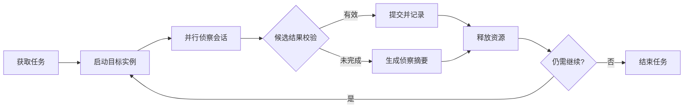

<p align="center">
  
</p>

<h1 align="center">PI Recon</h1>

<p align="center">
  轻量 harness：在授权 Agent 安全挑战里把「拉题 → 侦察 → 校验 → 摘要」跑成闭环。
</p>

<p align="center">
  <em>A thin AI red teaming harness for authorized agent / GenAI security challenges — not a heavy framework.</em>
</p>

<p align="center">
  
  
  
</p>

PI Recon 源自我们在百度安全挑战赛 / BCTF Agent Plus 攻防赛中的实践。赛程里很清楚的一点是：很多时候，一层足够薄的 harness——调度、超时、提交闸门、把上一轮试过的路径记下来——就能拿到不错的成绩；堆得很重的框架，在真正解题时未必有对应增益。

所以这个仓库刻意保持简单。它更像一套可自托管的 **AI red teaming tools** 雏形：把授权挑战里重复出现的几步串起来（取任务、起实例、有界跑 agent 侦察、校验候选结果、留下摘要），方便改 prompt、改并发、看日志。不是完整平台，也不是通用扫描器。

## 它做了什么

| 能力 | 作用 |
|------|------|
| 持续填槽调度 | 空闲并发槽自动补任务，避免队列尾部长期饿死 |
| 有界执行 | 单题硬超时，结束后释放平台资源 |
| 多阶段侦察 | 同题内续接上下文，少做重复探测 |
| 结果闸门 | 格式校验、去重、连续错误熔断 |
| 结构化摘要 | 技术栈、攻击面、已试路径、近失点、下一步建议 |
| 安全构建 | 日志、会话、密钥不进 Git，也不写进 Docker 镜像 |

## 工作流程



## 快速开始

要求 Python 3.10+，并确保 `pi` 命令在 `PATH` 中可用。

```bash
git clone https://github.com/weidutech/pi-recon.git
cd pi-recon

cp .env.example .env
# 在 .env 中填写 BENCHMARK_BASE_URL、BENCHMARK_TOKEN 和 PI_RECON_LLM_KEY

set -a
source .env
set +a

python3 harvest.py --only a-05  # 运行单个任务
python3 harvest.py              # 运行完整任务队列
```

## 项目结构

```text
harvest.py                 主调度器
platform_io.py             挑战平台 API 适配
agent_exec.py              侦察会话执行与事件记录
loot_gate.py               候选结果校验与提交控制
net_llm.py                 LLM 路由与连通性检测
orca_auth.py               OrcaRouter 凭据入口（API Key / OAuth 2.0 + PKCE）
orca_models.py             OrcaRouter 模型目录（实时 /v1/models + 已验证 seed）
tests/                     无网络的单元测试（本地 fake OpenAI 网关）
prompts/                   侦察提示词与方法规范
docker/                    容器构建与启动配置
scripts/watch_run_logs.py  运行状态查看工具
```

运行产生的 `jobs/`、`logs/`、`work/` 和 `dist/` 均为本地数据，不会提交到 Git，也不会复制进 Docker 镜像。

## Docker

构建过程不会接收或保存 API key。密钥仅在容器启动时通过环境变量注入。

```bash
MODE=tsec ./docker/build-baidu.sh
docker run --rm --env-file .env pi-recon:tsec
```

使用 `MODE=baidu` 可构建采用 Baidu AWD 网关配置的镜像。

## 配置

| 变量 | 默认值 | 说明 |
|------|--------|------|
| `BENCHMARK_BASE_URL` | 无 | 挑战平台 API 地址 |
| `BENCHMARK_TOKEN` | 无 | 挑战平台访问令牌 |
| `PI_RECON_LLM_KEY` | 无 | LLM API key |
| `PI_RECON_LLM_BASE` | `https://api.deepseek.com/v1` | OpenAI 兼容 API 地址 |
| `PI_RECON_LLM_PROVIDER` | `deepseek` | Provider 名称（可选 `orcarouter`，见下文） |
| `PI_RECON_LLM_MODEL` | `deepseek-v4-flash`（provider 为 `orcarouter` 时为 `orcarouter/auto`） | 模型名称 |
| `PI_RECON_CONCURRENCY` | `3` | 并行任务数 |
| `PI_RECON_JOB_TIMEOUT_SEC` | `1200` | 单任务超时秒数 |
| `PI_RECON_SEGMENTS` | `2` | 每个任务的会话阶段数 |
| `PI_RECON_JOBS_DIR` | `jobs` | 本地运行数据目录 |
| `PI_RECON_HINT_AFTER_FAIL` | `1` | 阶段失败后是否获取平台提示 |
| `PI_RECON_SECOND_WAVE` | `1` | 是否重试首轮未完成任务 |
| `PI_RECON_SUBMIT_MAX_WRONG` | `3` | 连续错误提交熔断阈值 |

提示接口可能影响挑战得分；不需要时请设置 `PI_RECON_HINT_AFTER_FAIL=0`。

### OrcaRouter Cyber Inference

[OrcaRouter](https://www.orcarouter.ai) Cyber Inference 是面向网络安全红蓝队的命名推理 provider：
为**通过业务验证的安全团队**放行**授权的、scoped** 安全推理请求（红队侦察、授权攻防挑战），基础地址始终为
`https://api.orcarouter.ai/v1`（OpenAI 兼容）。provider 页 https://www.orcarouter.ai/cyber ，
cyber 层模型目录 https://www.orcarouter.ai/models?tier=cyber 。

```bash
export PI_RECON_LLM_PROVIDER=orcarouter
unset PI_RECON_LLM_BASE PI_RECON_LLM_MODEL      # preset base + catalog default
python3 harvest.py --connect-orcarouter          # 两种接入方式任选其一
python3 harvest.py                                # 正常跑任务队列
```

两种接入方式并列可用，最终都会拿到同一把归用户所有的普通 `sk-orca-…` key：

| 方式 | 命令 / 配置 | 说明 |
|------|-------------|------|
| API Key | `PI_RECON_LLM_KEY=sk-orca-…` 或交互输入 | 已在 [console](https://www.orcarouter.ai/console/keys) 建好 key 的用户 |
| Connect with OrcaRouter | `python3 harvest.py --orca-auth pkce --connect-orcarouter`（`PI_RECON_ORCA_AUTH=pkce`） | OAuth 2.0 + PKCE（S256，无 client secret）；本地有浏览器走 loopback redirect，容器/SSH 用 `PI_RECON_ORCA_SCOPE=oob` 粘贴授权码 |

- 认证在 `https://www.orcarouter.ai`（`/auth`、`/api/v1/auth/keys`），推理与模型目录在 `https://api.orcarouter.ai/v1`。
  自托管可用 `ORCA_BASE_URL`，或分别覆盖 `ORCA_AUTH_BASE_URL` / `ORCA_API_BASE_URL`。
- key 存在本项目已有的 `models.json`（`providers.orcarouter.apiKey`），日志只打印掩码形式。
- PKCE 换回的是持久 key，不是 refresh token：relay 返回 401 时只把发出该请求的那一代凭据标记为
  `needs_reauth`，重新执行一次 Connect 即可，不会伪造 refresh 或每次启动重新授权。
- 模型列表来自 `GET /v1/models`（Bearer），实时目录优先；目录不可用时回退到已验证 seed
  （`orcarouter/auto`、`orcacyber-ultra-1.0`、`orcacyber-zero-1.5`、`orcarouter/fusion`）。
- 选择模型：`--orcarouter-model <id>` 或 `PI_RECON_LLM_MODEL`（裸写 `orcacyber-*` 会自动映射到 `orca/` 命名空间）；
  旧式 `--model` 在 OrcaRouter 下不会被当作模型 id，避免把 DeepSeek 默认值传给 relay。
- 模型推荐：默认 `orcarouter/auto`；安全团队可用 **OrcaCyber Ultra**（`orcacyber-ultra-1.0`）/ **OrcaCyber Zero**
  （`orcacyber-zero-1.5`）；通用兜底 `orcarouter/fusion`。`python3 harvest.py --orcarouter-catalog` 打印真实可调用列表。

> 仅用于你拥有明确授权的目标；OrcaRouter 只负责把请求送到模型，授权边界仍由你负责。

## 安全边界

PI Recon 只应用于你拥有明确授权的目标。不要用它扫描无关网络、执行拒绝服务攻击或访问未授权系统。

- 不要提交 `.env`、日志、会话、结果归档或私钥文件。
- 构建镜像时不要传入密钥；在运行时使用 `--env-file` 或密钥管理服务。
- 若密钥曾进入公开仓库、构建日志或已分发镜像，应立即撤销并重新签发。
